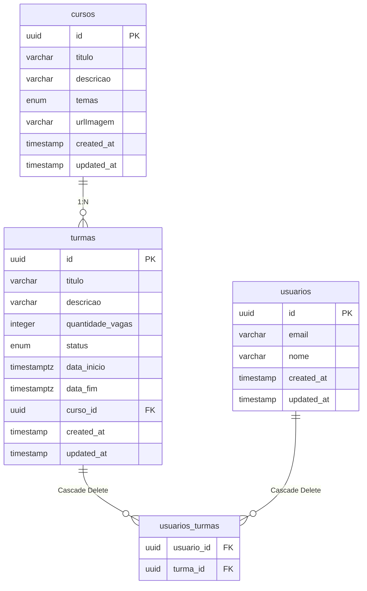

# API Course System

API desenvolvida para gerenciar cursos, turmas e matrículas de alunos.

## Tecnologias Utilizadas

- **Node.js** com **NestJS**
- **TypeScript**
- **PostgreSQL**
- **TypeORM**
- **Docker** e **Docker Compose**
- **Jest** e **Supertest** (Testes)
- **Swagger** (Documentação da API)

## Arquitetura e TDD

O desenvolvimento do backend foi guiado pelas melhores práticas e pela metodologia **TDD (Test-Driven Development)**, adotando também uma estrutura altamente escalável:

- **Arquitetura Modular**: O projeto é estruturado em módulos independentes (Cursos, Turmas, Usuários), seguindo o padrão recomendado pelo NestJS. Essa separação de responsabilidades (Controllers, Services, DTOs e Entities) garante alta coesão, baixo acoplamento e facilita manutenções futuras.
- **Testes Unitários**: Garantem o funcionamento isolado dos serviços (ex: `CursosService`, `TurmasService`, `UsuariosService`), utilizando _Mocks_ para testar validações, filtros e regras de negócios complexas (ex: turmas cheias, períodos de matrícula).
- **Testes E2E (End-to-End)**: Levantam a aplicação junto com um banco de dados real de testes, validando todo o fluxo HTTP. Os testes E2E cobrem desde a requisição nos `Controllers` até a resposta final, testando as regras críticas do banco de dados (como as restrições de _Foreign Key_ e exclusões com efeito _Cascade_).

## Modelagem do Banco de Dados

Abaixo está o diagrama Entidade-Relacionamento (ER) do sistema gerado com PlantUML:



## Como Executar

### Ambiente de Desenvolvimento Local

Você pode subir o banco de dados e rodar a aplicação localmente:

```bash
# Sobe o PostgreSQL via Docker (ambiente de dev)
pnpm run docker:up

# Instala as dependências
pnpm install

# Roda as migrations para criar as tabelas
pnpm run migration:run

# Opcional: Popula o banco de dados com dados fictícios (Seed)
pnpm run seed

# Roda o servidor em modo watch
pnpm run start:dev
```

### Ambiente de Produção

Para rodar a aplicação em produção utilizando o Docker com a imagem otimizada, primeiro renomeie o arquivo de variáveis de ambiente:

```bash
# Renomeia o arquivo de ambiente de produção para o padrão
cp .env.prd.example .env

# Constrói e sobe a aplicação + banco de dados
docker compose up -d --build

# Roda as migration
pnpm migration:run

# Popula o bando de dados
pnpm seed
```

---

_A documentação Swagger da API está disponível na rota `/api/docs` após a inicialização do projeto._
